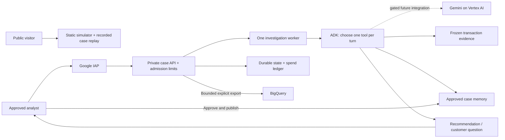

# MintTown

A fintech world and investigation workbench. Run the town: residents transact, simulated phishing and payment bursts create cases automatically, and a background ADK agent investigates. An analyst approves the resolution; reviewed knowledge then holds related payments before settlement.

The investigation uses **Google ADK 2.11.0** with native function calls. Local runs default to an explicitly labeled fake model. Hosted live mode requires all three operator switches (`MINTTOWN_CLOUD_LIVE_CANARY`, `MINTTOWN_LIVE`, `MINTTOWN_FRAUD_LIVE`) and is restricted to **one Gemini case**, including its follow-ups, under the existing spend limits. Startup never invokes the model. Fake-model tests establish the execution contract, not live AI accuracy.

## Run locally

Use Python 3.12.

```sh
python3.12 -m venv .venv
.venv/bin/python -m pip install -r web/requirements-google.txt
MINTTOWN_LIVE=0 MINTTOWN_FRAUD_LIVE=0 .venv/bin/python -B web/server.py
```

Open http://localhost:3000. **World** shows the town and its activity; **Agent** shows model identity, selected tools, evidence, proposed resolution and approved knowledge. The original light-and-mint visual system, DM Sans and canvas pixel art are self-hosted.

## Demo

1. Press **Run world**. A bounded backend worker advances at most 24 simulated hours. Changing tabs or hiding the browser does not drive or restart it.
2. A phishing attempt or three transfers four seconds apart opens a case automatically. The investigator chooses tools and produces a proposed resolution in **Agent**.
3. Review the evidence, then **Approve & remember**. The approved case enters the knowledge base.
4. A later transfer to that reviewed recipient is held by `payments.hold_transfer` before ledger posting. Repeat scenarios can use previously approved recipients, so existing knowledge also protects a new world episode. The receipt cites the memory; it creates neither a new investigation nor another model call. Other recipients remain unaffected.
5. Manual reports and the earlier memory-follow-up rehearsal remain under **Manual test cases**. Only simulator-owned cases receive synthetic customer replies; real submitted stories are never answered automatically.

Each Run request is idempotent against its run number. Episodes pause at 24 steps, at the durable world-work cap, on error or on server restart. New unknown scams stop creating reports when the investigation allowance is unavailable. World events do not enable extra model workers, retries or training jobs. The prevention rule is an exact match to an approved recipient, not a claim to recognize every phishing campaign or payment burst.

All transfers, recall requests and customer messages are simulated. No real money is moved. Only the operator can approve a case or publish memory.

The monetary contract is **PHP**, with 100 minor units per peso. The agent receives it explicitly. Reviewed-case lookup normalizes recipient aliases (for example, `demo-safety` matches `external:demo-safety`). A tool-contract correction can recheck the same unapproved case without creating a new customer report, changing the old trace, or resetting cost/call history.

## Programmatic verification

```sh
.venv/bin/python -B -m unittest discover -s web -p 'test_*.py'
.venv/bin/python -B web/simulate_adk.py
```

The HTTP rehearsal uses a temporary database, exercises the actual ADK runner and function tools, and forbids constructing a Gemini client. Its JSON report is written under `web/reports/`.

The first and second cases consume 5 + 5 simulated generations under the default 10-call daily allowance. The rehearsal proves the next case stops before making a model call, then uses a separate temporary database for the benign comparison. It never clears the saved application's ledger.

## Automatic execution and evidence

`POST /api/fraud-agent/start` queues automatic execution by default and returns HTTP 202 while queued/running. Repeating it reuses the same run. `automatic: false` retains manual stepping for diagnostics. Replies to automatic cases resume the worker. The worker pauses for a customer, analyst review, a cost/call limit, or an error. One worker runs at a time; refreshes and closed browser tabs do not cancel it. Restarted queued/in-flight cases require analyst attention and retain reservations instead of silently retrying.

Each investigation stores an immutable `fraud_evidence_snapshots` row: reported transfers, up to 60 prior payments within 30 days, up to 10 related transfers per recipient, and the latest 100 eligible reviewed memories. Retrieval returns at most 3 matching memories. Copies, capture time, simulator date, event watermark and a content hash preserve what was available, including when later transactions are backdated or history changes. Changes to the reported transfers still block automatic submission and analyst approval. A reply captures a new revision; old observations are reused only if the evidence hash is unchanged, and spending never resets.

The case's decision trail spans revisions and shows the selected tool, public purpose, observed result, snapshot/source references, failure status and actual or simulated cost. It does not expose private model reasoning.

## Budget controls

- Up to **6 model generations per case**, including follow-ups and re-investigations.
- **$0.02 per case**, **$0.10 per UTC day**, **$1 lifetime** and **10 calls per UTC day** by default.
- Reserve **$0.01 before a generation**, then reconcile reported input, output and reasoning tokens. Ambiguous failures retain their reservation.
- Fake calls use a separate simulated-spend ledger; actual model API cost remains zero. The main two-case rehearsal uses the normal 10-call daily allowance.
- Invalid tools, out-of-scope accounts, fabricated citations, stale evidence and repeated requests cannot bypass the server checks. A stopped run can be handed to the analyst explicitly.
- One active investigation and one queued investigation, a 180-second automatic-run deadline, and a 30-second deadline for each model turn. Customer replies keep the same case budget.
- Live calls are spaced at least 6 seconds apart with at most one live request in flight. SDK attempts are set to one; there are no automatic provider retries or model upgrades. A failed live turn opens a durable circuit breaker. An operator must reconcile its receipt before clearing the circuit; browser actions cannot reset it. These controls are implemented, but hosted Gemini remains disabled.

The local application assumes one server process owns its SQLite database. A distributed deployment needs database-level atomic reservations across service instances.

These are application admission limits, not an account-wide billing ceiling. Keep the database: deleting it resets the local spend history. Other scripts and direct Cloud Console calls do not pass through this ledger.

For Vertex AI, also configure a Google Cloud **spend cap enforcement** budget scoped to one dedicated project and `aiplatform.googleapis.com`. The current MintTown setup uses a **$1 monthly** cap, with notifications at 50%, 80% and 100%. Google pauses new eligible usage when the estimated threshold is reached, but reporting delays and in-flight requests can produce overages. The cap resets each month and does not cover unrelated services or persistent infrastructure charges. See [Google's spend-cap documentation](https://docs.cloud.google.com/billing/docs/how-to/budgets-spend-caps). Keep live calls off until the console shows the cap as **Configured** and authentication is ready.

## Gemini integration

The guarded Vertex AI adapter targets `gemini-3.5-flash-lite`. It remains disabled unless the server is explicitly configured with **both** `MINTTOWN_LIVE=1` and `MINTTOWN_FRAUD_LIVE=1`, a `GOOGLE_CLOUD_PROJECT`, supported `GOOGLE_CLOUD_LOCATION` (default `global`), and Application Default Credentials. The UI currently creates fake-mode investigations. No credentials belong in browser code or committed files.

Live model behavior, endpoint access and real token consumption still require an explicitly enabled evaluation. No fine-tuning, external MCP service or paid cloud deployment is required for the local demo.

Local Vertex setup uses an ignored `web/.env.vertex` file and an isolated Cloud SDK/credential directory under ignored `output/google-cloud/`. From the repository root, load the local file with `set -a; source web/.env.vertex; set +a` before starting the server. Both live switches remain `0`; loading the file never enables inference. User ADC inherits the signed-in user's Cloud permissions; it is not an IAM boundary for just this project. Use a dedicated service identity with inference-only permissions for deployment.

See [the investigation implementation](web/fraud_agent.py), [ADK adapter and fake model](web/fraud_adk.py), and [tests](web/test_fraud_agent.py).

## Hosted team demo

[The hosted MintTown demo](https://minttown-1040017899050.us-central1.run.app/) runs the same UI and API on Cloud Run in `minttown-apac-2026`. [deploy/plan.json](deploy/plan.json) records the default fake-only Cloud Run, Cloud Storage and BigQuery controls, provisioned by [deploy/provision.py](deploy/provision.py). A separately approved private pilot requires the three live switches and a temporary, project-scoped `aiplatform.endpoints.predict` grant. It cannot admit a second live case, and flags or client payloads cannot raise the fixed hosted cost limits. Browser access still requires IAP. Public access remains disabled. Teammate access must be granted separately.

For this small, single-worker demo, committed SQLite state is checkpointed to one Cloud Storage object using generation preconditions. Cold starts restore reports, snapshots, memory and budget history. Conflicts and uncertain writes fence the instance instead of overwriting another writer; a liveness probe restarts it. The database is capped at 64 MiB. This checkpoint design has a single-writer ceiling; move operational state to a transactional managed database before scaling instances or enabling cloud inference.

The hosted town has an explicit **Export next batch** action. Each atomic BigQuery load contains current `customers` and `accounts` snapshots plus the next unexported `financial_events` and their complete `ledger_entries`. The 37,066-row initial economy fits in two batches. Exports remain limited to 3 per UTC day, 20,000 records and 16 MiB each. The UI shows events still awaiting export. `POST /api/cloud/export` requires a stable `request_id`: retries replay that receipt, completed batches advance the event cursor, and unchanged data creates no load job. Failed/uncertain submissions retain their allowance; new batches wait until an uncertain job is confirmed. This is incremental ingestion of new events, not change-data capture for edits to historical events. Customer/account snapshots repeat across batches; use the latest `exported_at` for those records.

The application issues no analytical query jobs. The project query quota is 1 GiB per day. BigQuery partitions and staged exports retain 7 days of data; the live state object is retained and overwritten without object version history. Exporting is explicit, with no always-on scheduler or streaming pipeline.

Cloud Run uses one instance, one CPU, 1 GiB memory, no minimum instances, instance-based billing for the background worker, and a $1 monthly spend cap. Whole-project $5 alerts include other services but are not an overall hard cap. Google enforcement delays can cause overages. Cloud Build is bounded to a 600-second build. Credential/config/data/report directories are excluded by the explicit `.gcloudignore` and `.dockerignore` upload allowlists.

Hosted API access is limited to the town, scam desk, automatic investigator and bounded exports. Old training, macro-policy, marketing and manual-stepping routes are disabled in cloud mode. Background science training no longer runs at cloud startup or on a simulated day boundary. Limits are shared across viewers: 600 admitted writes, 240 world-step requests and 4 new report attempts per UTC day, with 60 writes and 120 API reads per minute. Write allowances are checkpointed before work and survive cold starts; failures retain them. Per-minute burst counters are process-local, so these are a supplement to IAP, durable daily admission and infrastructure controls, not an anonymous-traffic defense. The browser polls only active visible cases, backs off from 1.5 to 5 seconds, and stops after 210 seconds or on an error.

## Hosted rehearsal

[web/simulate_hosted.py](web/simulate_hosted.py) calls the actual Cloud Run endpoints through IAP using a 15-minute service-account JWT signed by IAM Credentials. It creates no service-account keys, grants no IAM roles, resets no budgets, and never enables Gemini. The caller needs an authorized, preferably temporary, runner identity with IAP access to this service and scoped permission to sign for that identity. [Google's IAP authentication guide](https://docs.cloud.google.com/iap/docs/authentication-howto) describes this authentication method.

```sh
# Load the existing ignored ADC configuration first. Never paste a token into this command.
PYTHONPATH=web .venv/bin/python web/simulate_hosted.py \
  --service-account=minttown-demo-runner@minttown-apac-2026.iam.gserviceaccount.com \
  --run-id=hosted-20261012
```

Reuse the run ID after an interruption. Mutation requests are never automatically retried. Read-only polling backs off to five seconds and stops after three minutes. Reports, approval and memory publication are replay-safe. The detailed receipt is saved locally under ignored `web/reports/hosted-investigation.json`; it contains synthetic case data, not credentials.

The October 12, 2026 hosted rehearsal completed with 10 fake-model turns, zero Gemini calls, a balanced ledger, and 21 GET / 8 POST requests. First case `SC-5c75a25565` was approved as a synthetic scam and published `MEM-5977ccbec9`. Second case `SC-a2b42ec772` retrieved that exact memory, asked its follow-up question, consumed the answer and returned to analyst review. The second transfer also received an ingestion-time reviewed-recipient flag. No money was refunded or real bank service contacted.

| First investigation, before approval | Second investigation, after approval |
|---|---|
| Get transactions | Search approved memory first |
| Search memory: no matching approved case | Get transactions and verify this case |
| Compare spending behavior | Ask the question from the approved case; pause |
| Trace recipient | After the customer reply, trace recipient |
| Submit for review | Submit for review, citing the approved memory |

This is in-context retrieval of analyst-approved knowledge. It does not change model weights or prove live Gemini investigation quality. The fake model supplies transparent fixture choices through the real ADK tools.

## Safe public demo plan — not enabled

Publish a separate **browser-only replay** first: the pixel simulator, synthetic report fixtures and a sanitized recording of the completed investigation. Bundle its data as static assets and run interactions in the visitor's browser. Give that site no operational API credentials, no Vertex permissions, no BigQuery export button and no connection to the private case database. The real analyst workbench stays behind IAP. This avoids per-visitor LLM calls and shared mutable cases; static hosting still needs its own traffic/billing controls.

Before publishing, verify its network traffic never calls the private API, scans find no credentials or customer-supplied content, and the demo clearly labels recorded/fake decisions. Do not make the current Cloud Run service anonymous: it contains analyst approval and shared-memory publication APIs. A future public live pilot needs login, customer/analyst roles, case ownership checks, independently enforced per-user and global limits, abuse controls, and transactional reservations across instances. Those are release requirements, not capabilities of the current single-writer demo.



## Private Vertex pilot and rollout

The user authorized a one-case live pilot on October 12, 2026. The first real Gemini pass on pending report `SC-bf5bfe0543` selected `get_transactions → compare_behavior → search_reviewed_cases → submit_for_review` and used four generations, with $0.002134 in metered token cost. It proposed analyst review and a recall. This run exposed a missing currency instruction and an overly literal recipient search; both contracts were corrected before analyst approval. The original response remains in the audit trail.

The same case was explicitly rechecked using its two remaining generations. Gemini selected `search_reviewed_cases → submit_for_review`, retrieved `MEM-5977ccbec9`, and submitted a corrected recommendation citing the memory and **₱1,200** transfer. **Total across both revisions: six calls and $0.003470**, measured from provider token usage at the pinned rates, excluding infrastructure charges. The case is awaiting analyst review. No refund or live bank operation occurred. The private pilot cannot admit a second live case or reset the six-call case allowance.

1. Keep the public replay separate from the private investigation service. Preserve the current hosted fake-only gate until an explicitly approved pilot. At activation, deliberately replace that gate with an operator-configured private-pilot gate; a browser request must never enable it. Reuse the dedicated MintTown runtime identity and add only the required Vertex prediction permission, scoped to this project. Keep its existing bucket/dataset grants scoped to the demo resources; add no service-account keys, broad Vertex job-management permissions, project-editor role or public invocation. Keep one instance and the existing durable admission ledger.
2. Use the existing `google-genai` Vertex adapter inside the metered ADK loop. Gemini receives a bounded case packet, chooses one of six allowlisted tools, reads its actual result on the next turn, and either asks for missing evidence or submits for analyst review. Approval and memory publication remain outside the model's tool set. No open-ended agent-to-agent loops, automatic escalation to a larger model, web grounding or model-training jobs.
3. Start with the pinned `gemini-3.5-flash-lite` model and re-check availability/prices immediately before activation. The current global standard price is $0.30/million input tokens and $2.50/million output/reasoning tokens. For illustration, five turns each using 3,000 input and 200 output tokens would cost approximately $0.007. This estimate excludes hosting and depends on actual usage. [Google pricing](https://cloud.google.com/gemini-enterprise-agent-platform/generative-ai/pricing).
4. Retain the 16,000-byte request envelope, 512-token output ceiling, one-cent reservation, $0.02/case, $0.10/day, $1 lifetime and 10-call daily gates. Cases may stop before six turns when a budget is insufficient. A 429, timeout, missing usage, invalid response or unsafe tool result stops the run; never sleep-and-retry the same paid request automatically. Further live calls remain blocked until operator review. Cold starts cannot reset cost history.
5. Evaluate synthetic held-out cases before expanding the pilot: impersonation, ambiguous reports, legitimate transfers, contradictory evidence, malicious report text, misleading prior memories, API throttling and interrupted requests. Check citations, question usefulness, safe stopping, false accusations, token use and latency. Google warns that minimal thinking can terminate multi-step tools prematurely, so compare reasoning settings deliberately within the existing evaluation budget; do not silently change them at runtime or schedule retries after the daily cap. [Model guidance](https://docs.cloud.google.com/gemini-enterprise-agent-platform/models/gemini/3-5-flash-lite).
6. After explicit approval, enable a small private live pilot and observe one case. Keep the dedicated project's existing Vertex spend cap as a second layer, retain a kill switch, and stop on any uncertainty. Move reservations and job ownership to a transactional managed database before increasing Cloud Run instances. Never treat Cloud Billing alerts or delayed spend caps as a guaranteed whole-project dollar ceiling.
