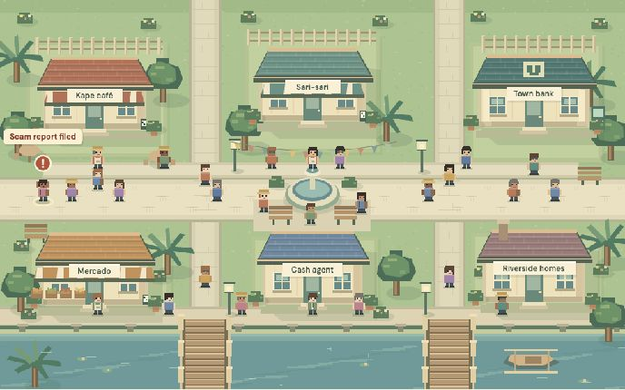

<p align="center"></p>

# Resolution Agent

**Customer complaint in. A resolution ready for human review.**

Resolution Agent investigates a customer's fraud complaint, gathers transaction evidence, calls relevant model tools and proposes the next action. A fraud analyst verifies the resolution. Approved lessons can protect a later payment, even when the scam uses a different recipient.

[Open the prototype](https://minttown-1040017899050.us-central1.run.app/) · [Demo script](docs/demo-script.md) · [Architecture](docs/harness-runtime.md) · [Team guide](AGENTS.md)



## Try it

Click **Start here**, follow the quick tour, then choose **Run demo**. Use **Next** and **Back** to follow the complaint, evidence checks, classifier result, proposed resolution, analyst review and prevention of a similar scam.

**Run demo** is a browser-only walkthrough of completed case evidence. It makes no model calls or API mutations. **Start simulation** is the separate active environment: it opens paused, with zero transactions and no old cases. Only an explicit start generates payments and reports. Restart preserves spending and safety counters.

## Architecture


| Component | Responsibility |
|---|---|
| Mint Town | Up to 100 residents generate wallet transactions and complaint events. |
| Data plane | BigQuery stores AE-shaped tables; trusted code freezes customer-scoped evidence at the case cutoff. |
| Resolution Agent | Gemini on Vertex AI and Google ADK choose tools, ask for missing information and draft a cited resolution. |
| Harness and analyst | Local checks validate tool contracts and evidence references. The human analyst owns approval. |
| Prevention Agent | Tests candidate safeguards against scams and legitimate lookalikes before separate human activation. |
| Payment gate | Applies active safeguards locally before debit, without an LLM call per payment. |

Shared checkpoints preserve case progress, receipts, approved knowledge and cost accounting. The case lead can request one scoped specialist or critic. A separate scientist/refiner/validator workflow produces advisory model candidates; it does not silently deploy them into payment decisions.

[Editable diagrams](docs/fraud-agent-mesh.md) · [Learning loops and research references](docs/learning-loops.md) · [Model tool contract](docs/model-artifacts.md)

## Start locally

Requires Python 3.12 and [uv](https://docs.astral.sh/uv/getting-started/installation/). The static web interface needs no frontend build.

```sh
uv sync --locked
MINTTOWN_LIVE=0 MINTTOWN_FRAUD_LIVE=0 uv run --locked python -B web/server.py
```

Open **http://localhost:3000/**. Offline investigations use an explicit fake model to exercise tool contracts. For real Vertex AI calls, follow [operations](docs/operations.md) with your own ADC and the shared allowance. Never run local and hosted writers against the shared ledger together.

## Data and model contributions

Gab's [dictionary and data tools](data/README.md) define `customers`, `wallets`, `devices` and `wallet_transactions`. Local generation is repeatable and capped at 100 residents. Validation is offline by default. Explicit imports can only fill empty, owned simulator tables; the AE's `minttown_simulated_env` stays protected.

Karlo's [ledger classifier](docs/ledger-model.md) is available through `score_models`. The integration preserves frozen temporal features, bounded exports, JSON inference parity and versioned receipts. Its measured recall is low: a low score cannot clear a complaint. Labels, demographics and label-derived risk scores are excluded from predictor inputs.

## Evidence and limits

- A saved live Gemini case selected the ledger classifier and proposed a resolution. Its reviewed prevention rule held a changed-recipient attempt with zero debit.
- An **offline synthetic** replay held **34/50** scam attempts and allowed **50/50** legitimate controls. These are test-bank results, not production fraud accuracy.
- Residents, payments and bank actions are simulated. Production resolution-time savings, real bank recovery and device-edge deployment remain unvalidated.

[Live results](docs/visual-demo.md) · [Evaluation scope](docs/evaluation.md) · [Model limitations](docs/ledger-model.md). Earlier failures remain documented.

## Cost and security

Shared model limits: **$2/day, $0.05/case, $8 lifetime, six calls/case**, one paid call in flight, six-second spacing and no automatic retries. Restarts preserve accounting. BigQuery retains row, byte and scan caps. The $20 project envelope uses delayed shutdown protection, not a guaranteed final-bill ceiling.

Credentials, raw exports, local ledgers and rendered video/audio stay out of Git. CI scans history for credential patterns and runs offline checks. See [SECURITY.md](SECURITY.md), the [release audit](docs/release-audit.md) and [hosting controls](docs/hosting.md).

## Develop and verify

```sh
uv run --locked python -B -m unittest discover -s web -p 'test_*.py'
node --test web/test_*.mjs
uv run --locked python -B web/evaluate_harness.py
uv run --locked python -B web/evaluate_cases.py --mode fake
```

| Area | Entry point |
|---|---|
| Simulator, app and agents | [web/README.md](web/README.md) |
| AE data tools | [data/README.md](data/README.md) |
| Deployment | `Dockerfile`, `deploy/`, `scripts/` |
| Editable video source | [demo-video/README.md](demo-video/README.md) |
| Guides and diagrams | [docs/README.md](docs/README.md) |

Use `uv add` and commit `pyproject.toml` with `uv.lock`. Read [AGENTS.md](AGENTS.md) before changing permissions, evidence handling or shared accounting.

Built by **Team Rocket** for the AI Builder Cup BFSI challenge. Team leader: **Lanz Vincent Vencer**.
