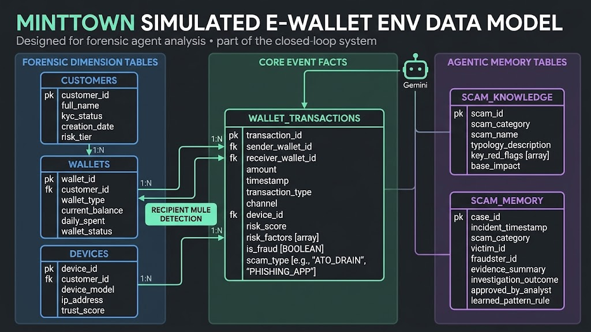

# AE data tools

Gab's four-table contract is shared by the simulator and model workstream. [Data dictionary](DATA_DICTIONARY.md) · [Runtime publication contract](../docs/environment-data.md)



The image is the original conceptual model. The dictionary and runtime schema define the exact field types and permitted agent projections.

## Generate and validate locally

```sh
uv run --locked python data/generator/generate_minttown_data.py --output output/ae-fixtures
uv run --locked python data/ingestion/load_to_bq.py --input output/ae-fixtures
```

These commands make **no cloud or model calls**. Defaults are 100 residents and 1,000 transactions. Generation uses numbered residents, documentation-only IP addresses, seeded data and a device owned by each sender. Existing CSVs are never overwritten. These fixtures do not settle balances or represent realistic fraud prevalence.

`risk_score`, `risk_factors`, `is_fraud` and `scam_type` are offline annotations. Never attach them, mutable wallet state or demographics as predictor features. Agents use the scoped contract in `web/ledger_fraud_features.py`.

## Optional import

The active world normally publishes through its own guarded publisher. Do not run a second writer alongside it. For an explicit offline import, stop both local and hosted world writers first:

```sh
uv run --locked python data/ingestion/load_to_bq.py \
  --input output/ae-fixtures --project YOUR_PROJECT_ID \
  --apply --world-stopped
```

Only existing, owned `minttown_world` tables are allowed. All four destinations must have the expected schema and be empty. Imports use `CREATE_NEVER`, `WRITE_EMPTY`, deterministic job IDs and zero upload retries. The tool never writes to `minttown_simulated_env`, provisions resources or replaces the investigation view. Row and byte caps apply.

Four loads are not atomic. A pending receipt may indicate partial or uncertain execution. Inspect its jobs; do not delete the receipt and retry. Keep receipts and generated rows out of Git.

The empty upstream SQL placeholder was omitted. Maintained schemas and ownership/partition controls live in `web/environment_data.py` and `web/environment_cloud.py`.

Gab owns the source schema and original generator/ingestion contribution (`f03a384`). Karlo's model contribution (`4858404`) is integrated with the newer guarded feature contract. The agent runtime owns case scope, receipts, review and prevention.
