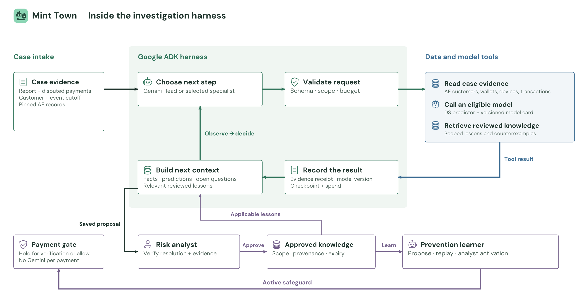

# Mint Town: an evidence-driven fraud investigation harness

Design proposal · sources checked 14 October 2026 · no runtime changes or paid evaluations

**Stack:** Google ADK / Gemini / Vertex AI / BigQuery, within the existing Cloud Run application.

## Recommended agent architecture

**Keep Google ADK and Gemini, put teammate-trained fraud models behind a typed tool gateway, and let one case lead selectively request specialist help.** Build the differentiator around verified evidence, justified tool selection and reviewed learning. A model supplies reasoning or a prediction; a harness supplies the execution loop, context, permissions, state, limits and validation around it. They solve different parts of the problem.

The case lead reconciles reports with transaction facts, checks model applicability, asks follow-up questions and prepares a supported resolution. Google supports coordinator and explicit agent-as-tool patterns; OpenAI distinguishes manager-owned specialist assistance from transferring the conversation. [1, 3]

Use five logical roles, with **zero or one specialist activated initially**:

| Role | Owns | Allowed contribution |
|---|---|---|
| Case lead | Investigation question, tool selection and final synthesis | Read evidence; score an eligible model; delegate; ask; submit |
| Transaction specialist | Spending, velocity and recipient relationships | Inspect transaction evidence and relevant model receipts |
| Device/identity specialist | Device and authorization questions | Assess available device evidence; explicitly request missing login/authorization facts |
| Scam-context specialist | Narrative, deception mechanism and alternatives | Compare the report with reviewed examples; identify a missing fact |
| Prevention learner | A reusable safeguard from an approved resolution | Propose or decline a candidate; cannot activate it |

These are role definitions within one guarded service. Three specialist boxes do not mean three compulsory Gemini calls. The existing scientist and model-risk validator stay in a separate research workflow; your teammate supplies model artifacts. Customer complaints do not launch model training automatically.



The main path is **case evidence → Gemini decision → validated tool execution → saved observation → next decision → human review**. Approved knowledge feeds later investigations. A separately approved safeguard feeds a deterministic payment check. The data plane stays with the AE's four tables; no bronze/silver/gold expansion is needed.

## What current research supports

University research and vendor guidance support selective coordination and explicit verification. The table separates demonstrated mechanisms from our proposed adaptations.

| Source | Useful finding or capability | Decision for Mint Town |
|---|---|---|
| Google Research / DeepMind / MIT, *Scaling Agent Systems*, April 2026 v3 | Across 260 configurations and six benchmarks, coordination benefits depend on task structure; sequential and tool-heavy tasks can suffer overhead | Compare selective delegation against a strong single-agent baseline under the same budget [8] |
| NVIDIA / HKU, *ToolOrchestra*, 2025 | A trained 8B orchestrator selects tools and other models while optimizing outcomes and efficiency | Present predictors with applicability, cost and score semantics; measure useful selections. Do not copy its RL training or assume its benchmark gains transfer to fraud [7] |
| NVIDIA NeMo Agent Toolkit 1.8 | ADK function-tool integration and profiling are documented | Optional offline instrumentation after compatibility tests; keep ADK as the runtime [6] |
| OpenAI Agents SDK guidance | Manager-owned helpers, tool-boundary validation and trace evaluation | Borrow these design practices without adding a second runtime or provider [3–5] |
| Stanford / SambaNova / Berkeley, *ACE*, ICLR 2026 | Structured, incremental playbook updates can preserve useful experience; poor feedback can degrade adaptation | Store small analyst-approved lessons with scope and provenance; avoid automatic prompt rewriting [9] |
| Virginia Tech, *Memory-Induced Tool-Drift*, May 2026 preprint | Irrelevant memories can influence tool parameters in its single-turn, fixed-tool benchmark | Bind permissions and thresholds in code; test distracting and revoked memories [10] |
| Peking University / Qiyuan, *Harness-Bench*, May 2026 preprint | Evaluates complete model–harness configurations, artifacts and traces under shared task conditions | Version the whole configuration and evaluate observable outcomes, not answer fluency [11] |

The latest fetched Google/MIT paper supersedes the January blog's earlier configuration count. ToolOrchestra's experiments include powerful model tools and much longer trajectories than our six-call allowance; its training used 16 H100 GPUs. It is useful design evidence, not a cheap training prescription. Harness-Bench's complete-configuration comparisons do not isolate the causal value of each harness component. None establishes Mint Town's fraud accuracy. [7, 8, 11]

**Model choice:** keep the configured `gemini-3.5-flash-lite` as the baseline. Google's current card recommends minimal thinking for extraction/routing but medium or high for autonomous multi-step subagents, warning about premature termination at minimal effort. Evaluate that trade-off rather than setting every role to the same effort. Google's current `gemini-3.6-flash` documentation makes it a reasonable later challenger, with stricter function-call response matching and changed API behavior. These are candidates to test, not grounds for a silent live upgrade. [12, 13]

Do not fine-tune or distill yet. First accumulate validated tool traces and identify repeated failures that prompts, tool definitions or data cannot fix. A self-hosted small orchestrator would introduce serving, training and evaluation work before we have evidence that it improves this small workload. NVIDIA's demonstration supports investigating that option later, not making it a dependency now. [7]

## Data and model tools

**AE data and teammate ML models** share this four-table contract: `customers`, `wallets`, `devices`, `wallet_transactions`. Resolve customer → wallet → disputed transactions → device and recipient context through server-owned, parameterized queries. Partition filtering uses the event date; transaction IDs disambiguate multiple events for one customer on the same date. Pin a snapshot/version and an `as_of` cutoff for each case.

Keep the fraud models outside the LLM. Your teammate delivers a predictor plus metadata; the agent chooses a permitted operation. In MCP terms, a model card is a **resource** and inference is a **tool**. Start with native ADK functions in this application; introduce MCP when the model team actually exposes an independently deployed service. The protocol is an integration interface, not an authorization mechanism or a reason to create another server. [15, 16]

| Teammate deliverable | Minimum contract |
|---|---|
| Model manifest | ID, version, task/positive class, eligible population, required inputs, training cutoff, artifact digest and release status |
| Feature builder | Deterministic transformations, units, time windows, available-before-payment rules and missing-value behavior |
| Predictor | Typed request/response; bounded CPU time or an allowlisted endpoint; no arbitrary executable or URL selection |
| Score semantics | Probability versus anomaly/rule score, calibration evidence, applicable threshold version, unsupported conditions |
| Evaluation bundle | Temporal and customer/group split definition, baseline, confusion counts, precision/recall, false-positive rate and calibration when claimed |
| Example fixtures | Valid request, legitimate case, suspicious case, missing-input case and expected contract behavior |

A small proposed interface is sufficient:

```text
get_case_evidence()
list_eligible_models(question)
score_models(model_ids, event_ids, purpose)
delegate_question(role, question, evidence_ids)
ask_customer(question)
submit_for_review(assessment, receipt_ids, uncertainties)
```

Case identity, customer scope, cutoff, feature values and approval rights come from trusted server context, not model-supplied arguments. The gateway checks the selected model against the pinned manifest, then returns a receipt containing model version, feature version, input hash, target definition, result, score kind, missing inputs and evidence IDs. Full data stays outside the prompt. A valid receipt establishes provenance; it does not prove that the agent's interpretation is correct.

**Do not average incompatible scores.** Low account-takeover risk and evidence of an authorized-payment scam can both be true. A known device does not settle whether a caller deceived the customer. An unavailable feature is `not_available`, not zero risk. A generic anomaly score is not a calibrated probability of victimization. Let disagreement prompt a targeted question or specialist review, with the relevant model targets visible to the analyst.

The inspected AE generator snapshot (`c2c6ed1`) assigns device IDs independently of the sender and derives `risk_score`/`risk_factors` from synthetic fraud labels. Hide `is_fraud`, `scam_type` and these label-derived fields from agent inputs and predictors; repair ownership and chronology before making accuracy claims. The four-table contract is usable for integration, but it is not yet evidence of a learnable, realistic fraud distribution. Validate it before fitting a supervised fraud model.

Initially, transaction history can support bounded behavioral anomaly tools. An account-takeover model needs coherent authentication evidence; a deception classifier needs request/message evidence. If those inputs are absent from the AE tables, return a missing-evidence result and use the complaint workflow. Do not manufacture confidence by treating demographic attributes, stress or a device identifier as proof of fraud.

Google's packaged BigQuery toolset includes broad SQL and model-building operations. Our recommendation is narrower: expose only the fixed reads and approved predictors needed for a case, preserving query-byte and daily limits. [22]

## The investigation harness

The attached harness illustration's six concepts map to concrete controls:

| Harness component | Mint Town design | Observable evidence |
|---|---|---|
| Agent loop | Lead chooses read, score, delegate, ask or submit; controller checks remaining allowance | Role, chosen action and brief public purpose |
| Tool calling | Schema validation, eligible model list and case-bound arguments before execution | Accepted/rejected call and versioned receipt |
| Context management | Policy + frozen case facts + relevant reviewed lessons + findings + unresolved questions | Context revision and evidence references |
| Checkpointing | Persist intent, reservation, response, tool result and next authorized transition | Resume point, input hash and spend receipt |
| Permissions/sandboxing | Read-only evidence access; trusted predictors; no free-form SQL, shell or model installation | Scope decision; denied action leaves state unchanged |
| Guardrails | Deterministic evidence/transition checks; human resolution approval; separate safeguard activation | Validation results and reviewer identity |

Google recommends developer-controlled tool context and reusable runner-level plugins for shared policies. OpenAI also cautions that agent-level input/output guardrails do not cover every nested tool call. Put the checks in the gateway itself, with hooks supplying consistent observation and enforcement across roles. Content moderation alone cannot validate a financial decision. Avoid adding a model-based guardrail to every step without separately budgeting those calls. [2, 4]

**Maintain a structured case record rather than a shared chat transcript.** Separate customer allegations, observed transaction facts, model inferences and analyst-confirmed findings. A proposed finding records its claim, supporting/contradicting receipt IDs, missing evidence and unresolved question. Store the complete audit trail durably; give the next role only the relevant slice. Preserve disputed amounts, evidence IDs and constraints through any compaction.

Delegation should be a contract: question, permitted tools, evidence scope, deadline, maximum generations and required return fields. The lead remains accountable for combining the result. Google's delegation research treats authority, monitoring and verifiable completion as part of delegation rather than just splitting a prompt. This design also targets MAST failures such as ignored findings, conversation resets and incomplete verification. [19, 21]

**Important local implementation detail:** the current adapter creates a fresh ADK in-memory session per turn and stops after one function call. Its durable application records supply continuity. Its in-flight check also treats `responded` model turns as busy while their tool work finishes. Simply inserting a nested `AgentTool` would therefore interact badly with the existing reservation/worker lifecycle.

For the first implementation, add a typed `delegate_question` action to the application controller: persist the parent task as waiting, finish its metered turn, schedule the child's bounded turn(s), commit the finding, then resume the lead. Every generation still traverses the existing meter. Treat native `AgentTool` as a later adapter only after nested-call, resume and budget tests pass. Avoid a child waiting on the same single-worker queue that is blocked by its parent.

A feasible upper-bound path illustrates the accounting, not a required sequence:

| Generation | Role | Decision |
|---|---|---|
| 1 | Lead | Read/score selected case evidence |
| 2 | Lead | Delegate one specific unresolved question |
| 3 | Specialist | Choose a relevant evidence/model tool |
| 4 | Specialist | Return a cited finding |
| 5 | Lead | Submit a resolution for human review |
| 6 | Prevention | After approval, propose or decline a safeguard |

A customer question can replace specialist work; it must not silently add another allowance. Simple cases can finish earlier. Essential evidence is a submission precondition, never waived to fit this table. If the case needs more investigation, stop with saved evidence and hand it to the analyst. Preserve $0.05/case, $2/day, $8 lifetime model spend, 100 model calls/day, one paid request in flight, six-second spacing and no automatic retries.

Keep task status separate from provider-call status and tool-effect status. On an uncertain paid response, retain the reservation and require reconciliation. A customer reply resumes the same allowance; a restart must not repeat a settled effect.

Before changing models, bind each allowed version to verified prices and a token reservation; unknown pricing fails closed. Remote predictors also need separate resource accounting.

Retain application-owned analyst approval. Current ADK confirmation documentation labels the feature experimental and lists limitations with database-backed session services. ADK rewind also does not reverse external effects or atomically restore all stores. Neither is a replacement for our case-review transaction, spend ledger or payment controls. [17, 18]

## Learning and prevention

**Learn a scoped lesson from a reviewed case.** Each entry records the mechanism, required observations, legitimate counterexamples, useful follow-up question, source receipts, reviewer, version, expiry and revocation state. Retrieve applicable entries with IDs; redact prior customers' identifiers. Draft allegations and unreviewed model output remain outside this store.

This adapts ACE's itemized, incremental updates. It deliberately differs from unrestricted self-improvement: the analyst supplies the publication gate, and replay tests examine proposed safeguards. ACE's financial benchmarks concern entity extraction and numerical reasoning, not scam adjudication; its paper also reports degradation when feedback is unreliable. Our proposed adaptation therefore needs its own evaluation. [9]

Keep three artifacts separate: an approved case finding; a reusable investigation lesson; and an active prevention policy. The prevention learner proposes an allowlisted condition set from the first two. Replay it against a changed-recipient scam and similar legitimate payments, then require a separate analyst activation. Run the resulting rule or approved small predictor before debit, with no Gemini call on every transaction. Revoke affected safeguards when their source knowledge is invalidated.

The most credible novelty is this combination of testable adaptations:

| Proposed contribution | What changes | How to falsify the claim |
|---|---|---|
| **Question-driven model selection** | Models are chosen to resolve a stated evidence gap, using target/applicability metadata | Compare with always-running every model and a single-agent tool baseline; measure supported resolutions per call |
| **Evidence-linked disagreement handling** | The case record preserves distinct model targets, contradictory evidence and missing facts | Change a model's target, remove required inputs or supply a legitimate lookalike; the agent must avoid unjustified confidence |
| **Reviewed lessons with counterexamples** | Reuse learns mechanisms while preserving when they should not apply | Replay unseen recipients/messages and legitimate controls; compare against no memory and unscoped memory |

The proposed contribution is a system that **chooses evidence, explains model relevance, and converts a reviewed resolution into a tested safeguard**. It does not claim a new foundation model or the first use of agent memory.

Memory can also cause harm. MEMDRIFT specifically studies irrelevant memories biasing parameters, not all tool selection or multi-turn failures. Use that evidence to motivate fixed server-side thresholds and access scope, plus negative-memory tests; do not claim that retrieval filtering solves the broader problem. A remembered case is never allowed to change the cost cap, customer identity, cutoff or approval requirement. [10]

## Evaluation and implementation

**Evaluate the model–harness pair and its final state.** Harness-Bench supports configuration-level comparison with artifact and trace checks. Tau-bench's useful precedent is checking the final database state and consistency across trials. For Mint Town, a plausible narrative is insufficient: the correct customer and transactions must be inspected, claims must reference valid receipts, and unauthorized policy activation must remain impossible. [11, 20]

Compare three arms with the same fixtures, data access and generation caps: a deterministic detector workflow, one Gemini investigator with tools, and the selective specialist design. Freeze model ID, thinking setting, prompt/tool versions, model artifacts, evidence snapshot, knowledge version and reviewer rubric. Change one factor at a time. Do not attribute a gain from a stronger Gemini model to the mesh.

| Test family | Required observation |
|---|---|
| Scam plus legitimate lookalike | Supported assessment; false positives reported separately |
| Normal device plus deceptive request | Appropriate follow-up or scoped specialist; authorization alone cannot establish legitimacy |
| Missing/expired/incompatible model | Explicit unavailability; no fabricated prediction |
| Changed customer, date or amount | Scope/unit checks reject the wrong evidence |
| Malicious report or irrelevant memory | No altered permissions, skipped approval or changed threshold |
| Restart, stale review, duplicate task | Same evidence and spend; no duplicate effect |
| Reviewed case → later payment | Measure scam interception and legitimate holds independently |

Use ADK's tool-trajectory checks for required invariants, not one compulsory investigation order. `IN_ORDER` or `ANY_ORDER` can accommodate essential calls; custom state assertions must still check scope and evidence. OpenAI's trace-evaluation guidance similarly asks whether tools and handoffs were appropriate. Record unsupported-claim rate, correct abstention, analyst acceptance/corrections, false holds, tool/model selection, generations, latency and billed/reserved cost. LLM judges are optional paid evaluation consumers, not free validators. [5, 14]

Start with offline contract tests using fake model decisions. They test execution, not Gemini's accuracy. A later authorized pilot could use eight fixtures across two configurations: 16 runs, with a planned allowance of up to 96 generations and $0.80 under the existing case caps, excluding infrastructure. Actual remaining allowances must permit it; never reset counters. This sample can expose failures, not establish production accuracy or a reliable rare-event false-positive rate.

Implementation order:

1. **Model boundary:** agree the DS manifest and receipt schemas; wrap one existing predictor; add missing-input, cutoff and scope tests.
2. **Case controller:** add typed delegated tasks and persisted findings to the existing worker; test parent/child scheduling and shared limits before live use.
3. **Verifier and review:** enforce evidence prerequisites, cited amounts, registered model versions, stale-state rejection and analyst-only publication.
4. **Learning loop:** add applicability and counterexample fields to reviewed knowledge; extend replay and revocation checks.
5. **UI and evaluation:** display the current question, chosen tool/model, receipt, unresolved issue, reviewer decision and later protection result. Show public decision summaries, never private chain-of-thought.

Existing modules already provide much of the foundation: `fraud_adk.py`, `fraud_agent.py`, `fraud_runner.py`, `warehouse.py`, `fraud_detectors.py`, `fraud_desk.py` and `prevention.py`. Extend these boundaries before creating a separate distributed-agent platform. Keep native functions first, optional MCP at service boundaries, and optional NVIDIA profiling in a separate uv dependency group after version checks.

Ship one instrumented case with a teammate model and a legitimate counterexample. Add roles when evaluation shows better evidence handling within the same budget. This design does not guarantee perfect fraud resolution.

## Sources

[1] Google ADK. [Multi-agent workflow patterns](https://adk.dev/workflows/patterns/).

[2] Google ADK. [Safety and Security for AI Agents](https://adk.dev/safety/).

[3] OpenAI. [Orchestration and handoffs](https://developers.openai.com/api/docs/guides/agents/orchestration).

[4] OpenAI. [Guardrails and human review](https://developers.openai.com/api/docs/guides/agents/guardrails-approvals).

[5] OpenAI. [Evaluate agent workflows](https://developers.openai.com/api/docs/guides/agent-evals).

[6] NVIDIA. [NeMo Agent Toolkit 1.8 framework integrations](https://docs.nvidia.com/nemo/agent-toolkit/latest/reference/frameworks-overview.html).

[7] Su et al., NVIDIA / University of Hong Kong. [ToolOrchestra](https://arxiv.org/pdf/2511.21689), November 2025.

[8] Kim et al., Google Research / Google DeepMind / MIT. [Towards a Science of Scaling Agent Systems](https://arxiv.org/pdf/2512.08296), v3, April 2026.

[9] Zhang et al., Stanford / SambaNova / UC Berkeley. [Agentic Context Engineering](https://arxiv.org/pdf/2510.04618), ICLR 2026, v3.

[10] Dabas et al., Virginia Tech. [Memory-Induced Tool-Drift in LLM Agents](https://arxiv.org/pdf/2605.24941), May 2026 preprint.

[11] Yao et al., Peking University / Qiyuan Tech. [Harness-Bench](https://arxiv.org/pdf/2605.27922), May 2026 preprint.

[12] Google Cloud. [Gemini 3.5 Flash-Lite](https://docs.cloud.google.com/gemini-enterprise-agent-platform/models/gemini/3-5-flash-lite?hl=en).

[13] Google Cloud. [Developer's guide to Gemini 3.6 Flash](https://docs.cloud.google.com/gemini-enterprise-agent-platform/models/guides/gemini-3-6-flash).

[14] Google ADK. [Evaluation criteria](https://adk.dev/evaluate/criteria/).

[15] MCP. [Tools specification](https://modelcontextprotocol.io/specification/latest/server/tools), resolved to 2026-07-28.

[16] MCP. [Resources specification](https://modelcontextprotocol.io/specification/latest/server/resources), resolved to 2026-07-28.

[17] Google ADK. [Tool confirmation](https://google.github.io/adk-docs/tools-custom/confirmation/).

[18] Google ADK. [Rewind sessions](https://google.github.io/adk-docs/sessions/session/rewind/).

[19] Cemri et al., UC Berkeley / Intesa Sanpaolo. [Why Do Multi-Agent LLM Systems Fail?](https://arxiv.org/pdf/2503.13657), NeurIPS 2025, v3.

[20] Yao et al., Sierra. [Tau-bench](https://arxiv.org/pdf/2406.12045), 2024.

[21] Tomašev et al., Google DeepMind. [Intelligent AI Delegation](https://arxiv.org/pdf/2602.11865), February 2026.

[22] Google ADK. [BigQuery tools](https://google.github.io/adk-docs/tools/google-cloud/bigquery/).
