# Agent roles and extension guide

## What is active

**Resolution agent:** `fraud_agent.py` and `fraud_adk.py`. Gemini chooses one native function call per turn. The next turn receives actual observations, remaining case allowance, the complaint and any customer reply. A final proposal includes evidence IDs, uncertainties, a customer-facing draft, a case-specific lesson and a future follow-up question.

| Tool | Allowed work |
|---|---|
| `get_transactions` | Verify only disputed IDs belonging to this customer |
| `get_customer_features` | Query this customer's pinned BigQuery feature snapshot |
| `compare_behavior` | Compare bounded historical spending in frozen ledger evidence |
| `trace_recipient` | Read bounded transfers to a recipient already in the case |
| `search_reviewed_cases` | Retrieve at most three approved memories |
| `train_behavior_model` | Train/reuse a bounded, advisory local model from BigQuery features |
| `get_complaint_guidance` | Read curated Philippine routing and evidence guidance |
| `ask_customer` | Ask one useful question and pause |
| `submit_for_review` | Propose a resolution and lesson; cannot approve or move funds |

Reading disputed transactions is required before submission. When the warehouse is enabled, BigQuery customer features are required too. These are evidence prerequisites; the remaining path and whether a model is useful are Gemini's decisions. Valid tool order need not be identical across cases.

**Prevention service:** the current payment gateway checks exact recipients from approved memories. It is a deterministic serving rule, not a second LLM agent. Its holds cite the reviewed source. It does not infer that every transfer resembling a scam is fraudulent.

## Proposed prevention-learning agent

Trigger it after an analyst-approved resolution. Give it a typed reviewed-case artifact, not authority to approve its own output. Its job is to propose a scoped reusable question, evidence checklist or prevention candidate. It should compare the confirmed case with legitimate lookalikes, explain exceptions, run shadow replay, and submit a candidate to an analyst.

```mermaid
flowchart LR
    Resolution[Resolution proposal] --> Human[Analyst approval]
    Human --> Artifact[Reviewed case artifact]
    Artifact --> Curator[Proposed learning agent]
    Curator --> Candidate[Candidate lesson or policy]
    Candidate --> Replay[Scam and legitimate replay]
    Replay --> Gate[Human activation gate]
    Gate --> Serving[Versioned prevention policy]
    Serving --> Outcome[Observed outcomes and rollback]
    Outcome --> Curator
```

A candidate artifact should include: source case and review IDs; applicable scenario; evidence required; counterexamples; proposed action; expiry/review date; test results; and version. Prefer a warning or a verification request for general patterns. An exact reviewed recipient can retain the existing simulated hold policy. New blocking logic should remain in shadow mode until evaluated and approved.

Neither agent may publish unreviewed allegations into active prevention, decide legal fault, promise recovery, or treat sentiment/demographics as proof. A bank-authentication record and informed intent are different questions. Approved memories remain leads that must be checked against the current case.

## Add a tool

1. Implement a small scoped operation in a dedicated module, following `warehouse.py` or `complaint_guidance.py`. Use case-derived customer IDs, fixed queries and explicit limits. Never accept arbitrary SQL or code from the model.
2. Add the function to `fraud_adk.tools_for`, its name to `TOOLS`, and the exact argument set to `ARG_FIELDS`.
3. Validate the operation in `FraudAgent.tool`; record its source references and public finding. Keep large datasets out of model context.
4. Bump the prompt/tool contract when its meaning changes. Old traces remain intact and case spending never resets.
5. Exercise the tool with an injected fake choice, then evaluate a small live sample through the shared ledger.

## Add another agent

Start only when a distinct decision boundary and evaluation exist. The current metering table is tied to investigations; a separate prevention job needs an explicit migration and shared budget accounting, not a fresh unmetered Gemini client. Preserve one paid request at a time, cumulative six-call case limits unless the operator deliberately changes them, request spacing and the persistent failure circuit.

Keep prompts, tools and success criteria distinct. A reviewed resolution is the handoff artifact; repeated agent-to-agent conversation is not the contract. Test an incorrect memory, a changed recipient, a legitimate lookalike, missing evidence, a timeout and an exhausted allowance before activating the new role. See [research](research.md) for the rationale and sources.
