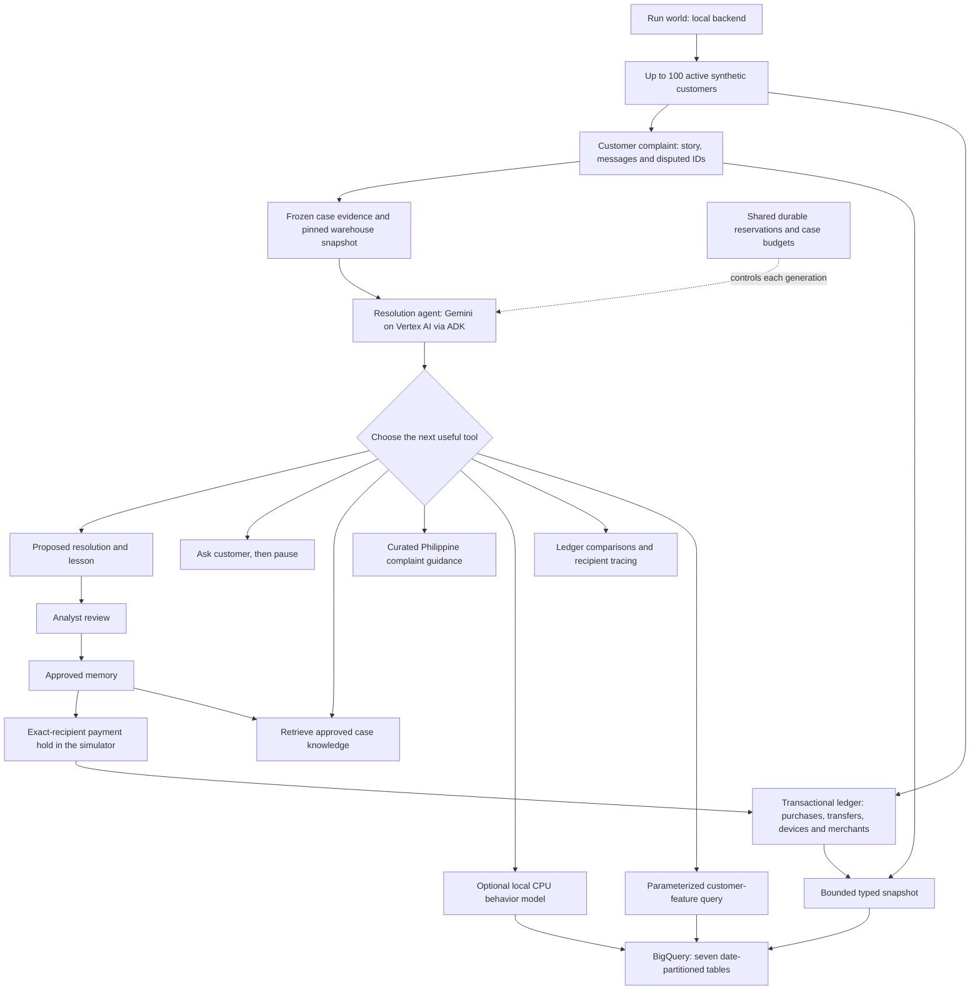

# Architecture

The browser starts an episode and reads progress. It does not drive model turns. A single background worker runs investigations. Live Vertex mode runs locally while Cloud Run is disabled, using the same GCS checkpoint and accounting history as the hosted app. A conflicting or unconfirmed checkpoint fences the writer.

## Warehouse

All seven tables include `snapshot_id` and are partitioned on `event_date`. Every tool query pins a snapshot and a bounded date range. Publications append a coherent version; an investigation can continue reading its earlier version while the world publishes another. Case tool outputs also preserve the query job ID and returned features in the decision trail.

| Table | Logical grain | Contents |
|---|---|---|
| `pallet_customers` | snapshot + customer | Synthetic profile, age band, region, occupation, income |
| `pallet_merchants` | snapshot + merchant/counterparty | Recipient identity, name and type |
| `pallet_transactions` | snapshot + event ID | Customer, event date/time, amounts, rails, recipient, status and device/authorization observations |
| `pallet_customer_daily` | snapshot + customer + event date | Counts, total/average/max spend, merchant diversity, device flags, minute bursts and income |
| `pallet_complaints` | snapshot + report | Customer story, message, disputed event IDs and workflow state at publication |
| `pallet_reviews` | snapshot + review | Analyst disposition, note and source case |
| `pallet_memories` | snapshot + memory | Approved lesson, future question, recipient pattern and validation receipt |

Customer ID plus date alone cannot uniquely identify multiple payments; event ID is the tiebreaker for transaction records. BigQuery does not enforce the app's logical primary keys. Queries must filter by snapshot so appended versions are not counted twice.

The feature window contains the current simulation day plus 28 prior days. Missing daily activity becomes a zero row, not a missing customer. Minute-burst counts use actual event timestamps. New world transactions carry simulation time; earlier historical fixtures with only a date cannot support minute-level claims.

Profiles and exports include at most 100 customers. Old records for additional customers are retained for audit, excluded from active generation and typed exports. Seven-day table expiration bounds this demo's storage without immediately deleting old simulated event dates. Tables are reprovisioned by the guarded launcher after expiry; there is no indefinite retention scheduler.

Publication happens before a new investigation starts. Normal events that occur afterward remain in the local ledger until the next bounded publication. This is snapshot-based ingestion, not real-time CDC. Workflow status in BigQuery is also a publication-time snapshot; operational case state lives in the app.

## Models

The available behavior model is genuine, bounded k-means training on BigQuery-derived customer histories: three clusters, 25 iterations, at most 100 customers. Stable customer hashing separates 80 training customers from 20 holdout customers. Each contributes up to 28 individual daily observations, using the same units as the day being scored. Features are payment count, spend in pesos, average payment and merchant count; incompletely recorded historical device/minute signals are excluded. The output reports distance and an unusual-behavior flag, not a fraud probability. Demographic fields are excluded. The holdout unusual fraction is a distribution diagnostic, not classification accuracy.

Models are reused by a fingerprint of their training rows, with at most two new local builds per day. There are no Vertex training jobs, GPUs or hyperparameter searches. A supervised fraud model needs suitably reviewed labels and separate validation; the current prototype does not claim to have one.
