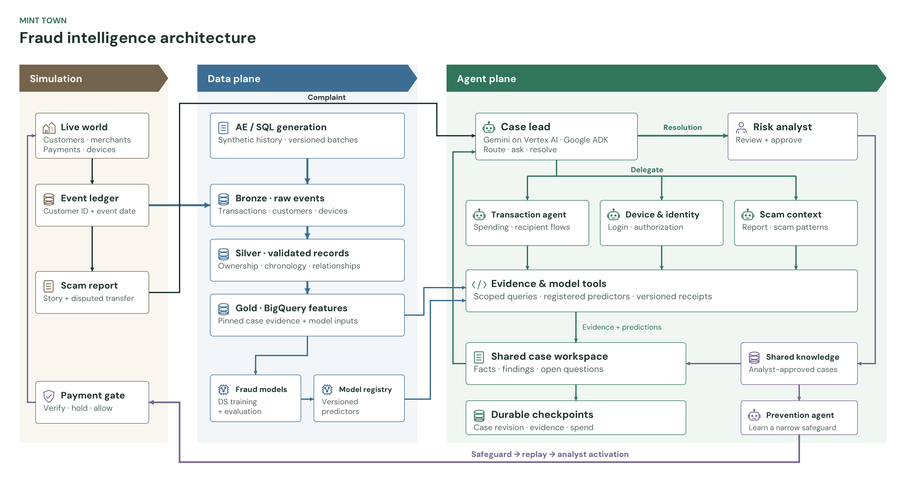
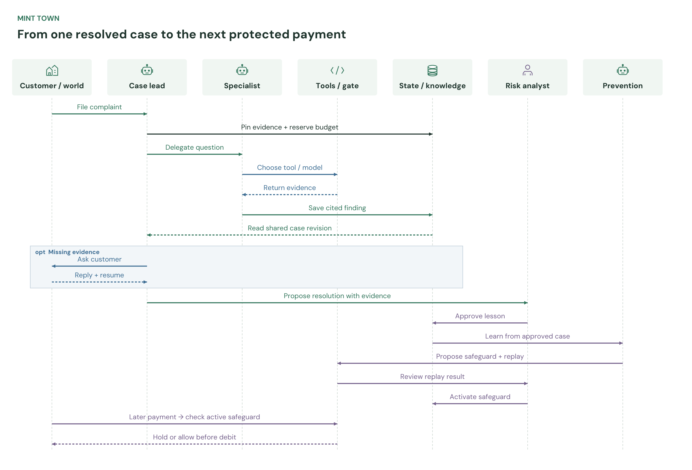

# Mint Town agent mesh

**Architecture and implementation scope.** New app cases use a case lead, one optional specialist/critic, shared receipts and local judges. See the [runtime guide](harness-runtime.md) for the tested boundaries. These figures show the broader design; longer specialist loops remain future work. The scientist/validator workflow stays separate.



[SVG](figures/mint-town-agent-mesh.svg) · [PDF](figures/mint-town-agent-mesh.pdf) · [Mermaid](figures/mint-town-agent-mesh.mmd)

## Three planes

| Plane | Responsibility | Owner |
|---|---|---|
| **Simulation** | Up to 100 customers transact; the ledger emits events; a customer files a report; the payment gate checks later transactions before debit | Environment workstream |
| **Data** | Use the AE’s `customers`, `wallets`, `devices` and `wallet_transactions` tables in BigQuery; expose the DS team’s trained models as tools | AE + DS teammates |
| **Agent** | Choose investigations and tools, combine findings, checkpoint the case, propose a resolution, learn reviewed safeguards | Agent workstream |

The AE branch is [feature/dummy-data-generation](https://github.com/VinceVence/apac-team-rocket/tree/feature/dummy-data-generation). Before ingestion, fix device ownership, account/payment chronology and duplicate IDs. Keep truth labels and label-derived risk scores in private evaluation data. SQL-generated rows are fixtures; the simulation ledger owns settlement and balances.

In this proposal, the world replays AE customers and transactions while investigators query the same records. The four AE tables are the starting contract; no additional warehouse layers are required for this design. The simulator now publishes six dictionary-shaped tables and a joined view to the isolated `minttown_world` dataset; investigation tools retain their pinned evidence snapshots. Each case pins the customer, disputed events, dataset version and evidence cutoff. Missing evidence stays explicit. Prevention features must exist before the payment decision.

## Follow the four steps

1. **Investigate:** the case lead reads AE data, chooses relevant models and delegates focused questions to specialists.
2. **Review:** the human risk analyst verifies the resolution and evidence.
3. **Remember:** approved findings enter shared knowledge for the next case.
4. **Prevent:** the prevention agent proposes a safeguard; replay and separate analyst activation precede local payment checks.

Shared notes and checkpoints support this flow inside the investigation team. The world image is a capture of the actual UI, generated locally with Gemini off.

The [harness design and research](agent-harness-design.md) specifies model contracts, checkpointed handoffs, shared cost limits and an evaluation plan.

## Agent responsibilities

| Role | Decision / tools |
|---|---|
| **Case lead** | Select 0–1 specialist initially, reconcile findings, ask a customer question or submit the resolution |
| **Transaction agent** | Inspect spending, velocity and recipient flows; select a compatible fraud model |
| **Device & identity agent** | Inspect enrollment, login and authorization; distinguish normal devices from suspicious behavior |
| **Scam context agent** | Compare the report with scam mechanisms, reviewed cases and legitimate explanations |
| **Prevention agent** | Use an analyst-approved case to propose a narrow safeguard or decline; replay before separate human activation |

These are logical roles within the existing guarded application. Specialists run only when selected. The scientist and validator remain a separate, bounded research workflow; complaints do not automatically train models.

## Shared state and orchestration

The lead delegates a **typed task** with a question and pinned case revision. The controller checks role permissions and shared allowance, then queues that role. The specialist chooses scoped evidence/model tools and returns a cited finding. The lead reads the updated workspace before its next decision.

- **Case workspace:** facts, model receipts, hypotheses, disagreements and open questions.
- **Checkpoints:** case revision, snapshot hash, model/knowledge versions, task state, tool-input hash, result references and spend receipts.
- **Shared knowledge:** analyst-approved lessons with source case, reviewer, version, expiry and revocation status. Draft hypotheses never publish themselves.

Reserve and persist each paid call before sending it; validate tool arguments; commit the result before advancing. Customer replies resume the saved revision. Failed or uncertain paid calls stop for reconciliation and keep their reservation. No automatic retries.

SQLite plus the existing generation-checked GCS checkpoint remains the recovery store. ADK's current in-memory session is not durable recovery. Keep one writer and one worker initially.

## Trained models as tools

The DS teammate supplies a trusted predictor and a manifest. The agent inspects the manifest and chooses whether to call it; the server supplies case-bound features.

| Contract | Contents |
|---|---|
| Manifest | ID/version, artifact hash, task, feature schema, positive class, score meaning, calibration status, training cutoff, evaluation reference, approval state |
| Tool | `score_fraud_model(model_id, event_ids, purpose)`; server injects snapshot, cutoff and access scope |
| Receipt | Prediction ID, model/feature versions, score kind, evidence references, missing inputs and latency |

Start with a registered local CPU predictor or versioned BigQuery batch predictions. Missing inputs return `not_available`. Rule scores and anomaly scores must not be presented as calibrated fraud probabilities. Agents cannot load arbitrary executables, release models or activate payment controls.

## Case flow



[SVG](figures/mint-town-agent-mesh-sequence.svg) · [PDF](figures/mint-town-agent-mesh-sequence.pdf) · [UML source](figures/mint-town-agent-mesh-sequence.mmd)

A useful first demo pairs a familiar authorized device with a deceptive payment request: the lead selects transaction and scam-context specialists, compares findings, asks for missing evidence, then proposes a resolution. An analyst approves the lesson. Prevention proposes a safeguard, replays legitimate controls, and waits for separate activation. A later matching payment is checked locally with **no Gemini call per transaction**.

## Implementation order and limits

1. Extend `fraud_runner.py` / `fraud_adk.py` with typed routing and role permissions; prove different selections with the fake model.
2. Extend case receipts/checkpoints for shared artifacts, stale-task rejection and exact resume.
3. Add the DS manifest/predictor adapter beside `fraud_detectors.py` and scoped warehouse tools.
4. Extend Agent activity to show role → question → tool/model → evidence → handoff. Retain human review and replay gates.

All roles share **six calls/case**, including prevention, plus the existing **$0.05/case, $2/day and $8 lifetime model caps**. Preserve one paid request in flight, six-second spacing, one queued job and no retries. Research has its existing two-call/$0.02 study allowance within the global meter. Preserve all BigQuery limits and the [project cost controls](hosting.md).

Rebuild the DM Sans vector and raster figures locally:

```sh
uv run --locked --group figures python docs/figures/render_agent_mesh.py
```
