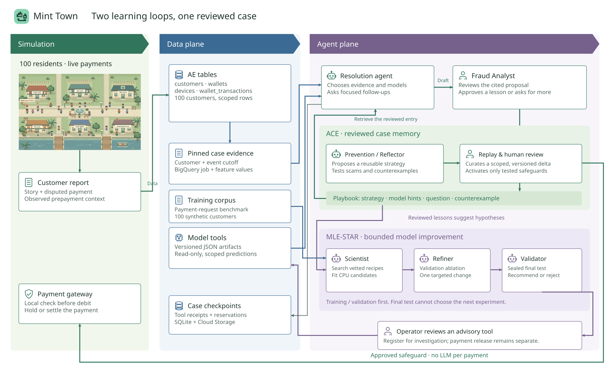

# Two learning loops, one reviewed case

Mint Town turns a reviewed fraud complaint into two reusable assets: **a scoped investigation playbook** and **a hypothesis for improving model tools**. The investigator decides what evidence to request. A human approves the case; later cases and payments benefit from the reviewed result.

This is a bounded adaptation of ACE and MLE-STAR, implemented on the existing ADK worker. It does not reproduce either paper's complete research system, and global novelty has not been established.

## ACE: reviewed case → reflected delta → reuse

ACE separates generation, reflection and curation, updating individual playbook entries rather than repeatedly rewriting a whole prompt. Entries can retain usefulness feedback. [ACE paper, sections 3.1–3.2](https://arxiv.org/html/2510.04618v3)

Our mapping:

| Responsibility | Implemented actor and evidence |
|---|---|
| Generate | Resolution agent chooses tools, reads pinned evidence and proposes a cited resolution |
| Reflect | Prevention agent uses one shared case generation to propose a narrow safeguard **and** an investigation strategy |
| Curate | Replay checks plus human activation accept the delta; trusted code stores its immutable payload and deduplicates retrieval |
| Reuse | A later investigator can retrieve the strategy, recommended model IDs, independent verification question and legitimate counterexample |
| Correct | Later analyst agreement/disagreement is attributed to cited entries; disabling/revoking the entry prevents reuse |

The proposal has no approval authority. A failed replay cannot activate the safeguard or playbook. Knowledge remains untrusted evidence: it cannot replace system instructions, prove a new accusation, grant permissions or add tools. Entry revisions are frozen with the case. Feedback counts reflect agreement with a later analyst decision, not causal proof of better accuracy.

The payment gateway still performs local checks before debit, with no LLM request per payment. Changed recipients and legitimate controls are tested against the same previous/candidate policy. A missing request cannot silently become a known-safe feature.

## MLE-STAR: search → ablate → refine once → sealed test

MLE-STAR uses search and targeted refinement guided by component ablations. Our implementation uses a vetted recipe catalog instead of arbitrary web-selected packages or generated code. [MLE-STAR paper](https://arxiv.org/abs/2506.15692)

The **scientist** selects word or character request features and states a hypothesis. Trusted CPU code fits that model and a payment-behavior reference. It reports validation errors and measures what happens when each input block is removed.

The **refiner** sees validation evidence only. It may change the request representation, change regularization, or keep the winner. It cannot change both components, alter thresholds freely, inspect the final test, or repeat the search. At most one further fit is allowed.

Trusted code nominates a candidate using validation results, then reveals the sealed final test. The **validator** can recommend the nominee or reject it. It cannot select another model because its test score looks better. The workflow uses at most **three model generations and three CPU fits**. Role transitions, checkpoints, tool permissions and execution limits belong to the harness. [ADK workflow semantics](https://adk.dev/agents/workflow-agents/loop-agents/)

Reviewed playbooks supply hypotheses, not labels. The request-learning benchmark has 1,000 synthetic examples across 100 customers, with separate customer, time and wording groups. Actual reviewed examples remain a separately curated data source; we do not relabel an agent's guess as training truth.

## Our models, available without waiting for a teammate

`train_request_predictors.py` builds two additional JSON predictors: **learned payment behavior** and **learned request patterns**. They join the previous synthetic baseline and three demo rules. They use versioned prepayment features and, where declared, the recorded request text. Later complaints, hidden simulator labels, demographic attributes and AE label-derived risk columns are excluded from inference.

The first development experiment improved validation scam detection from **41/60 to 44/60**, with **0/140 legitimate flags**. Its refined candidate detected **48/60** final-test scams but flagged **20/140** legitimate examples, so the payment-release gate rejected it. This failure stays visible. These are uncalibrated synthetic advisory tools, not approved blocking models.

A completed study's validation-selected artifact can be explicitly registered by an operator **for investigation only**, with its evaluation, limitations, digest and version. Registration does not approve payment serving, even when an operator wants to inspect a rejected candidate. Models cannot register themselves. Karlo can add a reviewed artifact later through the same bounded contract.

## What the experiment must prove

1. Real Gemini investigates a world-generated case using actual tool receipts.
2. Demo analyst approval feeds a Gemini-reflected playbook and tested safeguard.
3. A changed-recipient attempt is held before debit while a legitimate payment settles.
4. The same later evidence is investigated with reviewed memory available and withheld; record differences rather than assume memory helps.
5. Real Gemini chooses the scientist experiment and refinement; preserve the validator's actual outcome.

The operator endpoint accepts `knowledge_mode: reviewed | withheld` for controlled comparisons. Ordinary customers cannot alter that condition. Keep unsuccessful attempts, accounting, model versions and data provenance in the result file.

## Cost and reliability

Owner-approved changes remove fixed daily call/report/start/publication/query counters as admission gates. They remain telemetry. The model-call allowance is derived from remaining reserved dollars: **$2/day, $0.05/case and $8 lifetime model spend**, inside the existing $20 project envelope. Project billing shutdown is delayed, not a guaranteed bill ceiling.

One paid call runs at a time, with six-second spacing, six calls per case, no automatic retries, global HTTP throttles and bounded data payloads. A simulation pauses after a renewable 15-minute run lease. An invalid but fully accounted case draft stops that case; uncertain provider execution, missing usage or an exceeded token envelope still opens the shared circuit. No spending counters are reset.

Implementation: `fraud_playbook.py`, `prevention.py`, `risk_search.py`, `request_models.py`, `trained_models.py`. Verification: `test_learning_loops.py`, `test_spend_admission.py`, plus the existing suite. The Agents tab contains this architecture; Agent activity contains actual playbook reuse and Research lab contains search, ablation, refinement and rejection receipts.
