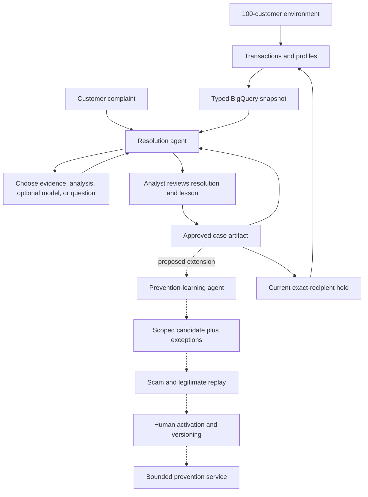

# Pallet Town: fraud resolution grounded in a living economy

This report records the initial five-case evaluation. Current operating limits and public live access are documented in [hosting](hosting.md).

## Pallet Town and the current Gemini evidence

Pallet Town should demonstrate a fraud analyst’s workbench: a customer reports a problem, an agent gathers relevant evidence, and a human reviews an actionable resolution. The simulator makes the evidence and consequences inspectable. It is useful because we control the transaction history and can test whether an intervention actually changes a later payment. A recommendation alone is not a resolved complaint, a recovered balance, or a validated fraud detector. [1, 2]

The implemented investigator uses Gemini on Vertex AI through Google ADK. It chooses a native function call, receives its actual result, and chooses again within a shared budget. The available actions include scoped ledger inspection, BigQuery customer features, historical comparisons, recipient tracing, approved-memory retrieval, a customer question, Philippine complaint guidance, optional local model training, and submission for review. Submission requires verified disputed transactions and, when enabled, the customer’s warehouse features. Those evidence prerequisites do not impose a fixed five-step itinerary. [1]

The earlier live pilot used six calls and $0.003470 across an initial pass and correction. It demonstrated tool execution and memory retrieval, but exposed currency and retrieval weaknesses. The October 13 five-case evaluation also caught an amount error. Both the original proposal and correction remain in the trace, and spending is cumulative across revisions. These findings do not establish production accuracy. [2, 25]

The product separates **Environment**, **Agent activity**, and **Agents**. They show the economy and data, the investigation trace, and the roles and authority boundaries. Agent names do not prove agency; tool choices and responses to evidence do. [1, 19]

## Five useful fraud scenarios

The catalogue covers five mechanisms, each paired with a legitimate lookalike. The cases are synthetic and source-grounded; they are not copied victim records. Counterparty and payment IDs in evaluation fixtures do not contain a fraud label. Expected outcomes are kept outside Gemini’s context. The offline fake model receives injected expected decisions solely to check execution contracts. [1, 2]

| Scenario | Investigation question | Useful evidence | Legitimate lookalike |
|---|---|---|---|
| Bank impersonation | Was a customer induced to move funds to a supposed safe account? | Message, disputed recipient, authorization record, independent contact history | A customer-initiated transfer to their own savings |
| Account takeover | Do device and authorization observations support unrecognized activity? | Timestamps, burst frequency, device observations, customer account of events | Several recognized market purchases in quick succession |
| Invoice redirection | Was a beneficiary change independently verified? | Original payment purpose, changed recipient, supplier callback and invoice records | A supplier change verified through a previously known contact |
| Task/job scam | Was payment required to unlock supposed earnings? | Escalating deposits, recruitment messages and withdrawal conditions | Payment for genuine training, with no promised job or commission |
| Investment/advance-fee scam | Are withdrawals conditional on another payment after guaranteed-return claims? | Deposit sequence, messages, withdrawal attempts and recipient relationships | A disclosed market loss through an independently verified provider |

The bank-impersonation case follows the FTC’s warning about moving money to supposedly protect it. A familiar device or successful authentication does not answer who induced the transfer or whether the recipient was honestly represented. The account-takeover case follows IC3’s description of impersonation leading to unauthorized account access; a burst alone is insufficient to establish that mechanism. [3, 4]

Invoice redirection follows the FBI’s business-email-compromise description. Its crucial difference from the legitimate control is independent verification of the changed beneficiary, not merely an unusually large payment. The FBI page’s indexed official summary was available, but its full article did not enter the fetched corpus; the prototype does not encode any recovery entitlement from that source. [5]

The task-scam case uses the FTC’s distinction between supposed earnings and demands for the worker’s own deposits. The investment case uses its warning about guaranteed returns and deceptive investment platforms. Neither case should be reduced to an amount threshold. The customer’s explanation and the conditions attached to withdrawing funds are necessary evidence. [6, 7]

These cases exercise different evidence needs, but remain an intentionally small demonstration set. A useful next evaluation must include paraphrases, ambiguous complaints, missing records, contradictory evidence, changed recipients, multilingual reports and independently labelled legitimate examples. Matching five known-positive fixtures is not a fraud-detection accuracy estimate. [2, 22]

## Environment and BigQuery data pipeline

The active environment and typed warehouse are capped at **100 customers**. The previous prototype contained a larger historical cohort; those records remain in the ledger rather than being deleted or used to reset budgets. Current generation and exports use the active cohort. Profile fields include synthetic age band, region, occupation and income, while fraud/model tools use behavioral evidence rather than demographic risk shortcuts. [8]

The seven typed tables share a `snapshot_id` and an `event_date` partition. [8]

| Table | Contents |
|---|---|
| `pallet_customers` | Synthetic customer profiles |
| `pallet_merchants` | Merchants and counterparties |
| `pallet_transactions` | Dated financial events |
| `pallet_customer_daily` | Daily behavioral features |
| `pallet_complaints` | Complaint snapshots |
| `pallet_reviews` | Analyst dispositions |
| `pallet_memories` | Approved lessons and provenance |

The transaction grain is snapshot plus event ID. The daily-feature grain is snapshot plus customer plus date. Customer ID and date alone cannot uniquely identify several payments on the same day. Queries pin a snapshot to avoid double-counting repeated publication versions. Features cover spending count and value, average and maximum payment, merchant diversity, explicit unknown-device observations, minute bursts and income. Missing daily activity is represented as zero, not a missing customer. [8]

Before a new investigation begins, the backend publishes a bounded snapshot. Gemini’s feature tool submits a fixed, parameterized BigQuery query using the case-derived customer ID and a bounded date range. It cannot choose arbitrary SQL, another project or another customer. The result and BigQuery job ID enter the saved decision trail. Later warehouse publication does not silently substitute different data into an existing case. [1, 8]

This is batch ingestion, not continuous streaming. Normal events after the last publication remain in the local ledger until the next admitted publication. Operational complaint state is authoritative in the app; the warehouse reflects publication-time state. This distinction matters when an analyst reviews a case after the day’s final export. A future CDC pipeline can improve freshness, but is not necessary to prove the current evidence flow. [8]

Model creation is also bounded. The agent can request a real local k-means behavior model using at most 100 BigQuery customer histories, three clusters and 25 iterations. A stable customer split supplies a small holdout, and model artifacts are cached by training-data fingerprint. Its distance and unusual-behavior flag are advisory. The holdout unusual fraction is a distribution diagnostic, not labelled fraud accuracy. No Vertex training job or GPU is launched. [8]

The right choice can be to skip training. A clear account of a changed beneficiary or a demand to pay before withdrawing wages may call for verification and case handling rather than a new model. Supervised fraud classification needs reviewed labels, a temporal/customer separation strategy and meaningful negative cases. The current data and five-case live exercise do not establish that readiness. [2, 22]

## Philippine complaint handling

The researched workflow begins with the financial institution’s own assistance mechanism. BSP’s official indexed complaint guide says to use the institution’s Financial Consumer Protection Assistance Mechanism first and escalate through BSP-CAM/BOB if dissatisfied with its action or response, retaining evidence of the earlier complaint. BPI’s published framework corroborates the provider-level FCPAM role and consistent complaint handling. [10, 11]

The agent should assemble a compact case packet: complaint reference, disputed transaction IDs, dates, amounts, recipient, narrative, message transcript, authorization/device observations, supporting records and unresolved questions. Urgent account-security concerns should be directed promptly to independently verified provider channels. The agent must not ask for an actual PIN, password, OTP or card security code, or make the customer follow a link supplied by the suspected scammer. [4, 10, 12]

A deceptive transfer and an unauthorized transaction require different investigation questions. GCash’s scam-reporting page describes a transfer made after deception, provides a reporting path from transaction history, and states that return of funds is not guaranteed. Its provider-specific process should not be turned into a universal deadline or refund promise for every Philippine bank and wallet. [12]

BSP Circular 1215 concerns regulated temporary holding of disputed funds and coordinated verification under AFASA. That is a reason to prepare an institution-led verification request, not to let a general-purpose LLM invent freezing authority. This simulator’s payment holds and recall receipts are explicitly synthetic. A real connector would need institution-approved procedures, authorization, idempotency, audit and human authority. [13, 21]

The BSP PDFs returned HTTP 403 during full-text extraction, and the chatbot page yielded no substantive body. Consequently, the app contains a conservative routing/evidence checklist with source links, not a claim of complete legal verification. It encodes no statutory resolution deadline, liability determination or reimbursement entitlement. The fetched GCash and BPI pages provide concrete provider examples; their rules are not silently generalized to every institution. [10–13]

The analyst should see verified facts separately from reported allegations and inference. Customer distress may warrant a considerate and timely response, but is not proof of fraud. Likewise, entering a PIN is not a sufficient basis for assigning blame. The app’s proposed customer message, case-specific lesson and future question remain reviewable outputs; approval and active memory publication are outside the model’s tool set. [1, 11, 21]

## Methods worth adapting

**Reviewed experience memory is the best first learning mechanism.** Reflexion demonstrates linguistic feedback and episodic memory without updating model weights. Pallet Town can adapt the idea by using analyst-reviewed feedback rather than allowing the model to treat its own confident reflection as truth. The useful memory is a scoped correction or investigative lesson, not an unreviewed accusation. This is a proposed financial-domain adaptation; the paper’s benchmark gains do not establish fraud performance here. [14]

**Contrast successful and failed investigations.** ExpeL extracts insights from successful trajectories and success/failure comparisons, then reuses relevant experience without gradient updates. Its practical implication is to store why a decision changed: the missing recipient verification, the contradictory device observation, or the misleading assumption. Pallet Town’s amount-formatting failure is an example of feedback that belongs in a tool/schema correction as well as an evaluation case. A generic instruction to be more careful is weaker. [15]

**Remember reusable investigative fragments, not rigid scripts.** Agent Workflow Memory induces reusable workflows and supplies them as context. Its reported difficulty in knowing when to diverge is directly relevant: a useful invoice-verification checklist should not force the same steps onto an account-takeover complaint. Store prerequisites, relevant evidence and stopping conditions, and let the agent select or reject the fragment for the current case. [16]

**Use legitimate counterexamples when promoting knowledge.** A proposed lesson should carry at least one counterexample, such as a burst of recognized purchases or an independently verified supplier change. Replay the candidate against both. A candidate that catches the scam but also blocks the control should remain a warning or verification prompt, not an active blocking rule. This contrastive promotion procedure is an original design proposal for Pallet Town, informed by experience-memory research rather than a newly validated fraud algorithm. [15, 17]

**Prune and correct memory.** The empirical memory-management study identifies error propagation and misleading experience replay. More stored cases do not necessarily produce a better investigator. Add source/review IDs, scope, version, exceptions and a review date; retain a way to revoke a lesson and measure whether later cases actually benefit. A superficially similar old case can be the wrong guide for a new customer. [17]

**Treat memory as an input-security boundary.** AgentPoison shows that poisoned memory or knowledge can redirect agent behavior. Customer messages, retrieved text and even analyst prose should remain data, not executable instructions. Use structured artifacts, scoped tools, bounded retrieval, approval gates and traceable activation. These controls reduce exposure but do not establish complete resistance to prompt injection or memory attacks. [18, 21]

**Separate reasoning from payment serving.** A model can propose a lesson or policy offline; the payment path should execute a small approved rule with a clear reason and rollback path. The current exact-recipient hold demonstrates this separation and consumes no model call for each payment. Broad generalization to unseen recipients remains future work and must be evaluated before activation. [1, 8]

These adaptations do not require LoRA, teacher distillation or a smaller proprietary model now. Experience retrieval, typed tools and a tiny CPU model address the current evidence and cost constraints. Fine-tuning would become a separate experiment only after collecting enough reviewed cases and an independent evaluation set. Closed-model experience-learning methods are relevant precisely because they do not require access to model weights. [14, 15]

## Resolution and prevention agent architecture

The cohesive design has an active **resolution agent**, a human review boundary, and a proposed **prevention-learning agent**. The second agent should be introduced for a different decision: determining whether a reviewed case supports reusable knowledge or a prevention candidate. It should not be an extra conversational persona attached to every transaction. Multi-agent failure research emphasizes specification, alignment and verification/termination problems; adding roles increases those obligations. [19]

The handoff artifact should contain source case and review IDs, verified facts, uncertainties, applicable mechanism, a proposed lesson, a future question, required evidence, counterexamples, permitted action and version. The prevention learner can request shadow replay and submit a candidate. It cannot approve its own policy, label an allegation as confirmed, or reset the investigation budget. This is a proposed extension contract; it is not an already-running second Gemini agent. [15, 19, 21]

ADK supports memory services and multi-agent/workflow composition, but a framework service does not determine whether a remembered claim is trustworthy. The current small reviewed-case store is sufficient to demonstrate the loop without provisioning a hosted memory runtime. Semantic retrieval or managed memory can be evaluated later against the present bounded retrieval baseline, including irrelevant and malicious memories. [20, 21]

The strongest competition proposition is therefore: **an evidence-grounded investigator whose reviewed outcomes can become tested, inspectable prevention knowledge**. The novelty is the closed experimental loop connecting customer complaints, a controllable economy, data lineage, agent choices, human review and later measurable effects. It is not a claim that an agent identifies every scam, autonomously resolves liability, or learns a reliable financial policy from one example. [1, 17, 19]

## Project structure and extension guide

The repository now has a short root README and a help index, with separate architecture, operations, agent-extension, research and evaluation documents. Backend responsibilities are explicit: `fraud_scenarios.py` owns fixtures; `warehouse.py` owns typed data, scoped queries and the optional model; `complaint_guidance.py` owns the curated checklist; `fraud_adk.py` defines native tools; `fraud_agent.py` validates them and meters model turns; `fraud_runner.py` controls background execution. [1, 8, 24]

A new tool belongs in a dedicated scoped operation, an explicit ADK function declaration, the argument allowlist, and a controller branch that records its provenance. Test it with a fake choice before live evaluation. A new agent needs a distinct job and reviewed handoff contract, plus an explicit budget/ledger integration. Creating another raw Gemini client with an independent counter would break the cost design. [1, 21, 24]

Historical macroeconomics and marketing modules remain for compatibility. They are not paid agents in the active Vertex workflow. Some offline regression fixtures retain their older population to test legacy model-release behavior; that does not increase the active simulator or BigQuery customer cap. Cloud resource names keep `minttown` so a visible rename does not create another project, bucket or accounting history. [8, 24]

## Evaluation and bounded rollout

Evaluation must distinguish four questions: does the software enforce its contracts; does Gemini complete the task with relevant evidence; does a learned lesson improve later investigations; and does a prevention policy avoid both scams and false positives? Offline fake tests answer the first question. The live five-case exercise begins the second. Paired memory ablations and shadow replay are still required for the last two. ADK explicitly evaluates both trajectories and final responses, and supports criteria with different costs and assumptions. [2, 22]

Do not grade every legitimate tool order against one exact itinerary. Enforce necessary prerequisites, scoped parameters, evidence citations, money units, human authority, stopping behavior and budget accounting. Report selected tools, questions, token usage, latency, failures, corrections and completion. A model that declines to train because the narrative and verified transactions suffice may be making the better decision. [1, 22]

Live evaluation uses the existing shared ledger, with $0.10 per UTC day, $0.02 per case, $1 lifetime, 30 calls per day and six per case. Five reports are admitted per day. SDK attempts remain one, live requests are spaced, and a persistent failure circuit stops further live work after an unresolved failure. Local execution avoids Cloud Run compute while retaining metered Vertex, BigQuery and Storage use. Google documents manual scaling zero as disabling the hosted service. [9, 23, 24]

BigQuery publication and queries have independent limits: three bounded publications per day, 20 queries per day and 50 MiB per query, with the existing project quota. Every generation reserves cost durably before contacting Gemini. Failed/uncertain external work retains allowance. No future paid evaluations are scheduled automatically, and neither an app restart nor a customer reply replenishes a case’s calls. [1, 8, 24]

All five live cases reached analyst review using **25 calls and $0.021283**, including one explicit amount correction. Every case queried BigQuery and Philippine guidance; account takeover skipped memory search. None chose model training or a customer-question tool in this sample, and none was automatically approved. The final warehouse snapshot has **5,896 rows** across seven tables. Costs use provider token metadata at pinned rates and exclude infrastructure charges; the original failure remains in the evaluation record. [23, 25]

The next credible experiment is small and specific: compare an investigation with and without a particular reviewed lesson on held-out paraphrases and legitimate controls. Measure whether the question becomes more relevant, fewer unnecessary tools are used, the evidence remains correct, and false accusations do not increase. Only after that should a generalized prevention candidate move from shadow replay to analyst-controlled activation. This tests whether the proposed learning loop helps, instead of treating memory growth or more agent roles as success. [15–19, 22]

## Sources

[1] Pallet Town investigation controller and native ADK adapter. https://github.com/VinceVence/apac-team-rocket/blob/main/web/fraud_agent.py

[2] Google ADK, Why evaluate agents. https://google.github.io/adk-docs/evaluate/

[3] FTC, Never move your money to protect it. https://consumer.ftc.gov/consumer-alerts/2024/03/never-move-your-money-protect-it-thats-scam

[4] FBI IC3, Account Takeover Fraud via Impersonation of Financial Institution Support. https://www.ic3.gov/PSA/2025/PSA251125

[5] FBI, Business Email Compromise; official indexed summary used, full article body unavailable in this fetch. https://www.fbi.gov/how-we-can-help-you/common-frauds-and-scams/business-email-compromise

[6] FTC, Task scams create the illusion of making money. https://consumer.ftc.gov/consumer-alerts/2024/11/task-scams-create-illusion-making-money

[7] FTC, Investment Scams. https://consumer.ftc.gov/articles/investment-scams

[8] Pallet Town typed warehouse and model implementation. https://github.com/VinceVence/apac-team-rocket/blob/main/web/warehouse.py

[9] Google Cloud, Manual scaling. https://docs.cloud.google.com/run/docs/configuring/services/manual-scaling

[10] BSP, How to file a complaint with BSP-CAM, September 2025; official indexed summary used, full PDF fetch blocked. https://www.bsp.gov.ph/Inclusive%20Finance/How-to-file-a-complaint-with-BSP-CAM-Sep2025.pdf

[11] BPI, Financial consumer protection framework. https://www.bpi.com.ph/about-bpi/governance/financial-consumer-protection

[12] GCash Help Center, Report a scam. https://help.gcash.com/hc/fil/articles/4413295284377-Report-a-scam

[13] BSP Circular 1215; official indexed summary used, full PDF fetch blocked. https://www.bsp.gov.ph/Regulations/Published%20Issuances/Images/Circular_1215.pdf

[14] Shinn et al., Reflexion: Language Agents with Verbal Reinforcement Learning. https://arxiv.org/abs/2303.11366

[15] Zhao et al., ExpeL: LLM Agents Are Experiential Learners. https://arxiv.org/abs/2308.10144

[16] Wang et al., Agent Workflow Memory. https://arxiv.org/abs/2409.07429

[17] Xiong et al., How Memory Management Impacts LLM Agents. https://arxiv.org/abs/2505.16067

[18] Chen et al., AgentPoison: Red-teaming LLM Agents via Poisoning Memory or Knowledge Bases. https://arxiv.org/abs/2407.12784

[19] Cemri et al., Why Do Multi-Agent LLM Systems Fail? https://arxiv.org/abs/2503.13657

[20] Google ADK, Memory. https://google.github.io/adk-docs/sessions/memory/

[21] Google ADK, Callback patterns. https://google.github.io/adk-docs/callbacks/design-patterns-and-best-practices/

[22] Google ADK, Evaluation criteria. https://google.github.io/adk-docs/evaluate/criteria/

[23] Google Cloud, Agent Platform generative AI pricing; global standard Gemini 3.5 Flash-Lite rates retrieved October 12–13, 2026. https://cloud.google.com/gemini-enterprise-agent-platform/generative-ai/pricing

[24] Pallet Town local operation, budgets and evaluation commands. https://github.com/VinceVence/apac-team-rocket/blob/main/docs/operations.md

[25] Pallet Town measured evaluation, including failures and corrections. https://github.com/VinceVence/apac-team-rocket/blob/main/docs/evaluation.md
