# Risk scientist and validator

Open **Agent activity → Model experiments** (`#models`). This adds two bounded ADK roles to the resolution and prevention workflow. Saved experiments are public and read-only. Curation and new studies require a private operator token.

```mermaid
flowchart LR
    World[Simulation: evidence before payment] --> Case[Resolution agent + analyst review]
    Case --> Curator[Operator verifies label and provenance]
    Curator --> Dataset[Immutable curated examples]
    Benchmark[Explicit synthetic benchmark] --> Checks
    Dataset --> Checks[Schema, timing, customer and support checks]
    Checks --> Scientist[Scientist: experiment or request labels]
    Scientist --> Fit[Allowlisted CPU recipes]
    Fit --> Select[Select using validation data]
    Select --> Gate[Untouched test: accept or veto]
    Gate --> Validator[Validator: recommend or reject]
    Validator --> Review[Human model review: no automatic deployment]
```



## What the agents decide

The **scientist** reads the manifest and training-only aggregate statistics. It chooses `design_experiment` with one or two approved recipes and useful feature groups, or `request_labels` to decline fitting. A successful plan includes a falsifiable hypothesis. The agent cannot read individual test labels or generate executable code.

The fitting tool trains real CPU models: a mandatory amount-only logistic baseline, plus the selected L2 logistic regression and/or small gradient-boosted tree. A narrow existing rule provides a reference. Thresholds and the nominated candidate are selected using validation data only. The final test can reject the nominee; it cannot promote a different model. Ties prefer the simpler logistic model.

The **validator** receives measured results and counterexamples. It can recommend only the validation-selected candidate that passed the server's gate, or reject the study. It cannot bypass a failed gate, refit, change thresholds, activate a model, or spend another call. This is a distinct tool-limited role using the same Gemini family, not an independent external audit.

The UI shows the hypothesis, both agents' actual tool choices, fit duration, rejected candidates, caught scams, false holds, counterexamples, artifact hashes, provenance and metered cost. Public explanations are concise decision summaries, not hidden chain of thought.

## Two deliberately separate datasets

**Curated cases:** an operator explicitly verifies a resolved case's label against the analyst disposition and records a rationale. Public demo approval alone never creates a training example. Each record includes the case/review/event IDs, scene, label source, frozen feature version, evidence hash and curation time. Examples are immutable and repeated curation is idempotent.

The simulator now captures features and their observed timestamp before posting a payment. These describe device/authorization signals, request content signals, recent payment behavior and amount relative to history. Customer IDs, later complaint text, demographics, investigator conclusions and hidden scenario labels are not model inputs. Older events without this recorded snapshot are quarantined rather than reconstructed from later reports.

**Synthetic benchmark:** an operator can explicitly load 1,000 generated requests across at most 100 existing synthetic customers. Its labels are generator truth, not analyst labels. It is useful for exercising real fitting and rejection when the small reviewed-case corpus cannot support training. The UI keeps its counts, studies and limitations distinct.

Both sources use disjoint customer cohorts: C001–C060 for training, C061–C080 for validation, C081–C100 for test. The benchmark also has separate July/August/September event windows and scam request templates. Checks require features available by the payment decision, labels after the event, training labels before validation events, and validation labels before test events. New reviewed cases must actually meet these timing and support requirements; a handful of approvals is insufficient.

The minimum support is 20 scams + 40 legitimate controls in training, and 10 scams + 20 controls in each holdout. Insufficient data stops before any model call. The demo release gate requires test recall ≥80%, false holds ≤5%, and improved recall over the narrow reference. Amount-only baselines are never release candidates. These fixed thresholds illustrate a review process; they are not a bank's production validation policy.

## Storage and serving

Four SQLite tables store examples, frozen studies, candidate artifacts and role-call receipts. They persist in the existing private GCS checkpoint across fresh scenes. Existing seven-table BigQuery ingestion and investigation tools remain in use; this first research feature reads frozen simulator snapshots, not new BigQuery training jobs.

Artifacts contain numeric coefficients or tree descriptors, not executable pickle files. They are research records, not a deployed endpoint. The existing analyst-approved prevention rules continue to protect simulated payments. Building a model release/shadow-serving agent is a separate next stage.

## Operator use and limits

Set `MINTTOWN_RISK_OPERATOR_TOKEN` to a private random value of at least 24 characters on the server. Keep it in an ignored file or the deployment's private configuration; never commit it. The operator form holds it in page memory only and sends `X-MintTown-Operator` alongside the normal same-origin token. All `/api/risk-lab/*` writes require it. Google Cloud service administrators can access service configuration, so distribute it only to trusted operators.

1. Review a case and add it through **Operator controls → Add to curated dataset**, with its supported label and rationale.
2. Inspect dataset checks. For a development demonstration, explicitly load/select **Synthetic benchmark** instead.
3. Choose fake-model rehearsal or live Gemini, then run one study. Repeating the same dataset/provider returns its saved study, including failures.
4. Inspect rejections and the validator result. No button deploys these candidates.

| Bound | Limit |
|---|---|
| New studies | 2 per UTC day; 20 retained studies |
| Dataset | 1,200 total examples across both sources |
| Research generations | 2 per study: scientist once, validator once |
| Research spend | $0.02/study, within the existing shared $2/day and $8 lifetime model limits |
| Training | At most 3 CPU fits; 32 trees at depth 2 or 150 logistic iterations |
| Training timeout | 20 CPU seconds and 25 wall seconds in a child process |
| Concurrency/retries | Existing single shared worker, six-second paid-call spacing; no automatic retries |

The child uses fixed trusted recipes and a minimal environment. It is not a general code-execution sandbox. No GPU, managed training job, model endpoint, new scheduled job or new cloud service is provisioned. The six-call fraud-case ceiling and all project cost protections remain unchanged. Restarting or resetting the scene preserves research charges and records.

## Programmatic verification

```sh
.venv/bin/python -B -m unittest discover -s web -p 'test_risk_lab.py'
```

The injected fake model exercises the actual ADK tools and real CPU fits without constructing a paid client. Tests cover distinct tool choices, requests for more labels, rejection enforcement, test-label isolation, timeouts, operator authorization, immutable curation, shared budgets, scene reset and GCS restore. Fake choices establish execution correctness, not Gemini reasoning quality.
